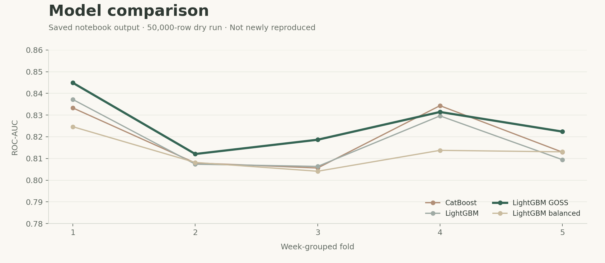

<p align="center"></p>

<p align="center">
  <a href="#overview">Overview</a> &nbsp;·&nbsp;
  <a href="#results">Results</a> &nbsp;·&nbsp;
  <a href="#getting-started">Getting started</a> &nbsp;·&nbsp;
  <a href="#project-notes">Project notes</a>
</p>

<p align="center"><b>LightGBM + CatBoost</b> &nbsp; / &nbsp; Home Credit &nbsp; / &nbsp; Week-aware evaluation</p>

## Overview

Loan-default prediction from application records and financial histories. This project combines case-level feature aggregation with several gradient-boosting configurations and an average of their predicted probabilities.

It builds on a **2024 course project** and the supplied final notebook, with a separate cleaned implementation for reproducible experiments. The focus is on comparing discrimination across models and application weeks, while making the validation protocol explicit.

| Data preparation | Models | Evaluation |
| :--- | :--- | :--- |
| Join financial histories by `case_id` | CatBoost and three LightGBM setups | Week-grouped CV or a later-week holdout |
| Aggregate repeated records | GBDT, GOSS, class balancing | ROC-AUC, average precision, Brier score |
| Align dates and categories | Equal-weight probability ensemble | Weekly metrics and complete confusion counts |

## Results

The values below come from the **saved outputs of the original notebook**, which ran on the first **50,000 training rows** in its dry-run branch with five week-grouped folds. These historical results have not been newly reproduced here. The cleaned code has a different preprocessing and evaluation implementation.

| Model | Mean fold ROC-AUC | Fold standard deviation |
| :--- | :---: | :---: |
| CatBoost | 0.8188 | 0.0139 |
| LightGBM | 0.8180 | 0.0144 |
| LightGBM GOSS | 0.8259 | 0.0127 |
| LightGBM balanced | 0.8127 | 0.0077 |

<p align="center"></p>

LightGBM GOSS has the highest mean fold AUC in this saved run. The original notebook did not report an out-of-fold score for the combined ensemble; no ensemble result is inferred from the individual model scores. Standard deviation describes variation across folds, not a confidence interval.

Exact historical values are in [the results CSV](results/historical_fold_scores.csv). New runs save separate result tables, figures, and experiment metadata under `outputs/`.

## Getting started

**1. Download the data**

Get the [Home Credit Credit Risk Model Stability data](https://www.kaggle.com/competitions/home-credit-credit-risk-model-stability/data) through your Kaggle account and unzip it. Full competition data is not stored in this repository. See [data setup](docs/DATA.md) for Parquet and CSV layouts.

**2. Install the environment**

Use Python **3.11 or 3.12**, preferably in a virtual environment.

```bash
python -m pip install -r requirements.txt
```

**3. Run a manageable first experiment**

```bash
python credit_risk.py --data-root data/raw --max-cases 20000 --iterations 150
```

The default is five-fold week-grouped validation on a seeded sample. Groups stay separate, but this does **not** require training weeks to precede validation weeks.

For a strictly later-week evaluation:

```bash
python credit_risk.py --data-root data/raw --validation temporal --holdout-weeks 13 --max-cases 20000 --iterations 150 --output outputs/temporal
```

Use `--max-cases 0` for all training cases after confirming the sample run fits your environment. Model selection uses development data, and evaluation folds are predicted only after fitting. Weekly diagnostics are reported separately from the official Kaggle stability metric, which is not implemented.

Prefer a notebook? Open [Credit_Risk_Gradient_Boosting.ipynb](Credit_Risk_Gradient_Boosting.ipynb). It is self-contained, with a Kaggle data path and a local-path option.

**4. Check the outputs**

| Output | Purpose |
| :--- | :--- |
| `metrics.csv` | Pooled out-of-fold or temporal-holdout metrics |
| `fold_metrics.csv` | Per-fold results and selected tree counts |
| `weekly_metrics.csv` | AUC/Gini and class counts by application week |
| `model_comparison.png` | Model and weekly comparisons |
| `run_metadata.json` | Versions, seeds, fold weeks, and sample size |
| `submission.csv` | Test-case probabilities, when test tables are available |

The test template's ten examples are unlabeled; they exercise formatting, not accuracy evaluation.

## Project notes

- [Method and implementation changes](docs/METHOD.md)
- [Original notebook and saved outputs](reference/original_notebook.ipynb)
- [report](reports/STOR565_Final_Report.pdf)

The report describes other experiments, including XGBoost and stacking. This repository follows the newly supplied **CatBoost/LightGBM soft-voting notebook** and does not claim to reproduce those other experiments.

Run correctness checks with:

```bash
python -m unittest discover -s tests -v
```

Tests use synthetic records to check aggregation, date transformations, category handling, and validation boundaries. Synthetic tests do not establish performance on real credit data.

## Maintainer

**[Zhetao Zhang](https://github.com/ZhetaoZhang998)**
